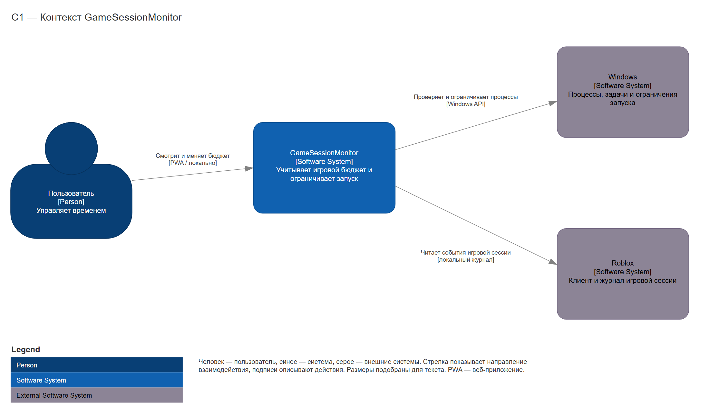
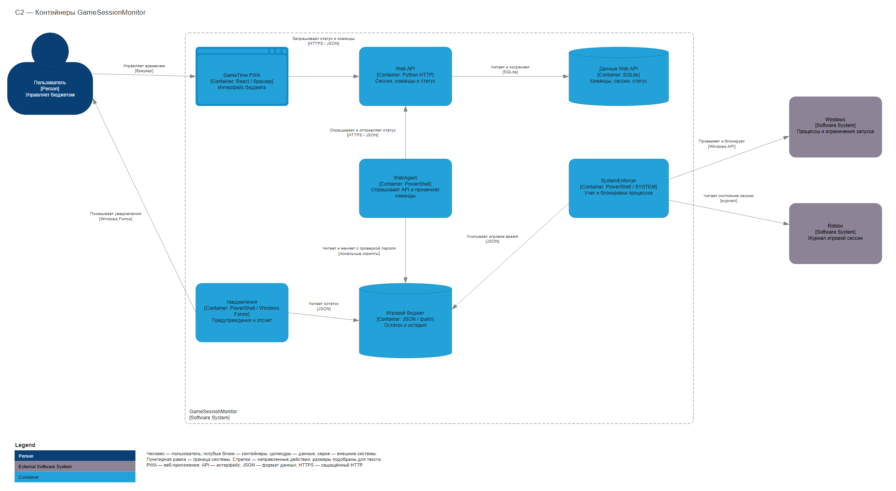
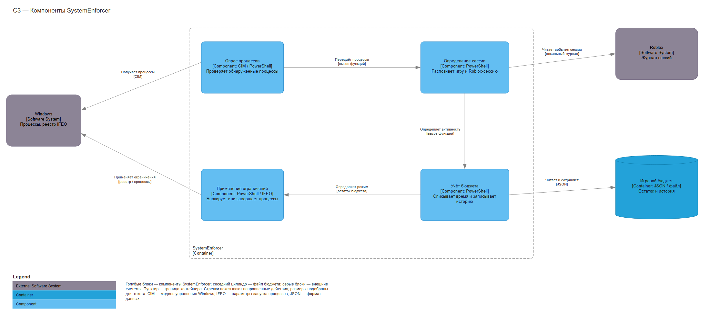
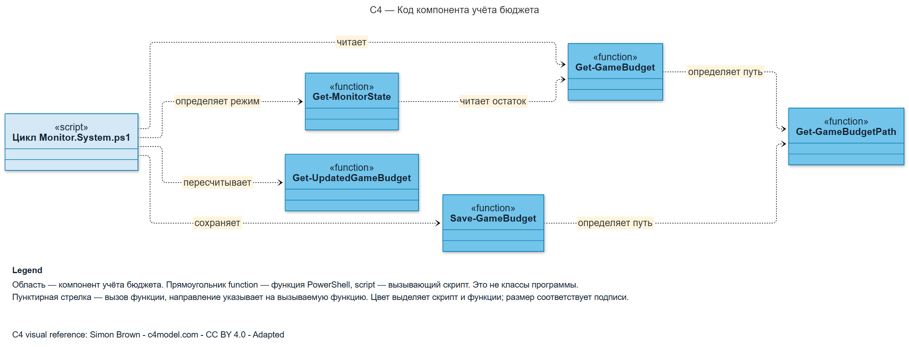
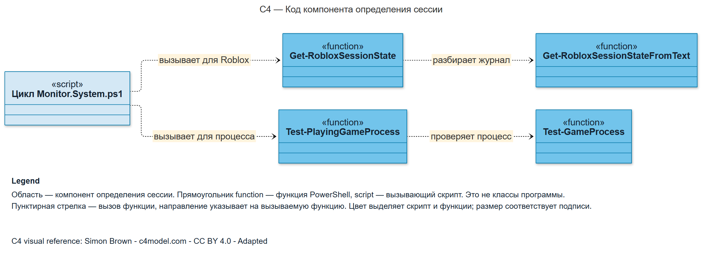
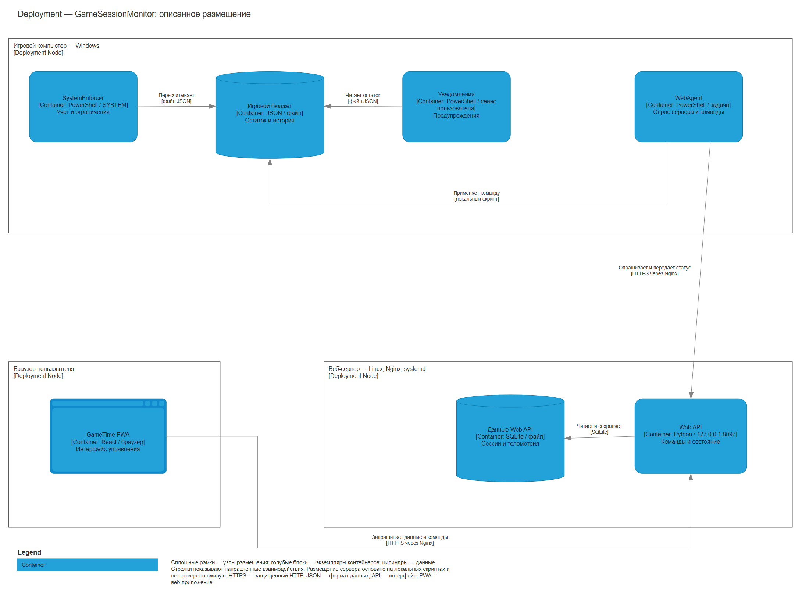
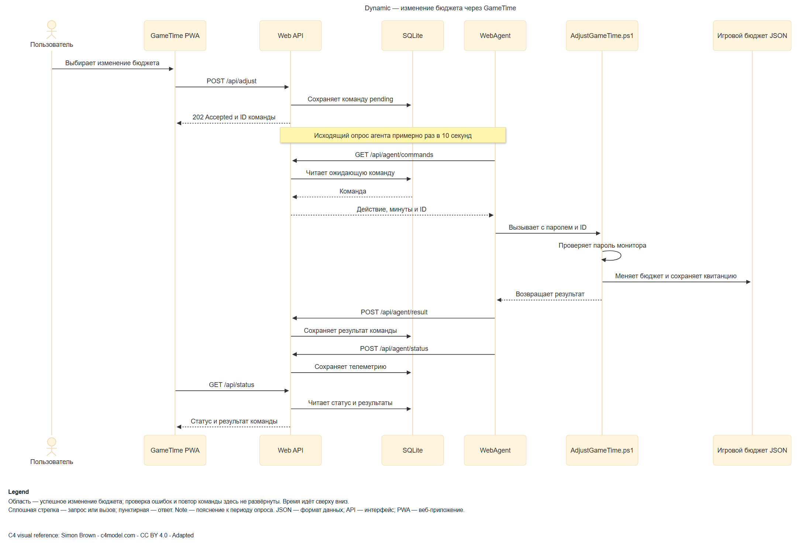

# C4 Mermaid

Version: **1.4.0**.

A self-contained, air-gap-ready Agent Skill for **Codex, Claude Code, Kimi Code CLI, and DeepSeek Harness**. Analyze a local application repository or supplied description and produce evidence-based C4 architecture diagrams in Mermaid with original draw.io C4 vector geometry.

- Correct mapping of systems, containers, components, and code.
- Mandatory external-system coverage across Landscape, System Context, and Container views.
- Compact layouts inside boundaries, with readable text, labels, and arrows.
- Consistent shapes and colors based on the C4 examples.
- All 21 C4 review criteria plus evidence, layout, export, and air-gap gates.
- Mandatory PNG, SVG, editable Mermaid (`.mmd`), and native draw.io (`.drawio`) delivery for every diagram.
- Mandatory visible arrowheads and evidence-based direction checks across all four formats.
- Nine editable Mermaid templates and a metadata-described GameSessionMonitor gallery.
- Exact native draw.io C4 shapes in Mermaid, without generic glyph substitutions or image cells.
- Mandatory user-supplied draw.io C4 assets, native XML templates, an importable shape library, and complete Apache-2.0 notices.
- Native editable draw.io export, typed shape checks, layout preflight, and round-trip examples.
- Mermaid 12.3.0 browser engine, local viewer, and complete license texts.
- Offline installation, tests, and SHA-256 integrity verification.

All authored material is in English. Project deliverables can use the user's requested language. No external page, package registry, CDN, icon service, or remote renderer is required. The agent application and inference backend must already be available inside the isolated environment; model weights and host runtimes are not included.

For connected installation through ChatGPT Desktop / Codex or Claude Code, the repository includes native marketplaces and a ready-to-install plugin. Repository-only setup instructions are in `DESKTOP-INSTALL.md`; the packaging audit is in `HARNESS-PACKAGING.md`. Both are separate from this offline skill bundle. The plugin contains the same complete skill and uses a local source within its checkout. Kimi and DSH use the standalone skill directory.

## Install from a transferred bundle

Extract the complete `c4-mermaid` directory from approved local media. From that directory, optionally verify and install using an already-installed Python 3.9 or newer:

```sh
python scripts/verify_bundle.py
python scripts/install_skill.py --target codex
```

| Target | User destination | Invoke |
| --- | --- | --- |
| `codex` | `~/.agents/skills/c4-mermaid` | `$c4-mermaid` |
| `claude` | `~/.claude/skills/c4-mermaid` | `/c4-mermaid` |
| `kimi` | `~/.kimi/skills/c4-mermaid` | `/skill:c4-mermaid` |
| `deepseek` | `~/.dsh/skills/c4-mermaid` | Ask to load `c4-mermaid` |

Choose the corresponding `--target`. Add `--scope project --project-root /path/to/application` for a project installation, or `--dest /configured/skills/c4-mermaid` for an exact custom directory. Installation verifies the bundle, makes no network calls, refuses an existing destination, and does not configure the harness. Start a new session if discovery is stale.

Without Python, copy the complete directory manually to the appropriate location and disclose that automated integrity verification was not performed. Updating also uses a transferred, verified bundle; no online updater is part of the workflow. See the [air-gap runbook](references/airgap.md) and [harness guide](references/harnesses.md).

Example request:

> Load the c4-mermaid skill. Using only this local repository and bundled references, create System Context and Container diagrams. Include evidence, assumptions, rendered previews, and checklist verdicts. Keep all processing inside the air gap.

## GameSessionMonitor example gallery

These owner-supplied diagrams illustrate the skill on an application. Captions and scope limits are translated from the accompanying [JSON metadata](assets/examples/game-session-monitor/metadata.json); the diagrams retain their original Russian labels. They describe the supplied model, not a fresh audit of the running application. PNG and SVG copies are hash-checked against the supplied metadata. Native draw.io companions preserve separate editable nodes, relationships, and annotations.

### C1 - System Context

Shows GameSessionMonitor as one system, its user, and its interactions with Windows and Roblox.

Scope: System context.



[PNG](assets/examples/game-session-monitor/c1.png) · [SVG](assets/examples/game-session-monitor/c1.svg) · [Mermaid](assets/examples/game-session-monitor/c1.mmd) · [draw.io](assets/examples/game-session-monitor/c1.drawio)

### C2 - Containers

Shows the web interface, API, web agent, system monitor, notifications, data stores, and their connections to Windows and Roblox.

Scope: Containers of GameSessionMonitor.



[PNG](assets/examples/game-session-monitor/c2.png) · [SVG](assets/examples/game-session-monitor/c2.svg) · [Mermaid](assets/examples/game-session-monitor/c2.mmd) · [draw.io](assets/examples/game-session-monitor/c2.drawio)

### C3 - SystemEnforcer Components

Expands process polling, session classification, budget accounting, and enforcement inside SystemEnforcer.

Scope: One selected container: SystemEnforcer.



[PNG](assets/examples/game-session-monitor/c3.png) · [SVG](assets/examples/game-session-monitor/c3.svg) · [Mermaid](assets/examples/game-session-monitor/c3.mmd) · [draw.io](assets/examples/game-session-monitor/c3.drawio)

### C4 - Budget Accounting Code

Shows the PowerShell functions that read, recalculate, and save the game budget and determine the monitor mode.

Scope: Code within the budget-accounting component.



[PNG](assets/examples/game-session-monitor/c4-budget.png) · [SVG](assets/examples/game-session-monitor/c4-budget.svg) · [Mermaid](assets/examples/game-session-monitor/c4-budget.mmd) · [draw.io](assets/examples/game-session-monitor/c4-budget.drawio)

### C4 - Session Classification Code

Shows PowerShell function calls that classify game processes and determine the Roblox session state.

Scope: Code within the session-classification component.



[PNG](assets/examples/game-session-monitor/c4-classifier.png) · [SVG](assets/examples/game-session-monitor/c4-classifier.svg) · [Mermaid](assets/examples/game-session-monitor/c4-classifier.mmd) · [draw.io](assets/examples/game-session-monitor/c4-classifier.drawio)

### Deployment - Described Installation

Shows the described placement of the monitor on a Windows PC, the PWA in a browser, and the API with SQLite on a web server, together with their connections.

Scope: Described deployment; current remote-server state has not been verified.



[PNG](assets/examples/game-session-monitor/deployment.png) · [SVG](assets/examples/game-session-monitor/deployment.svg) · [Mermaid](assets/examples/game-session-monitor/deployment.mmd) · [draw.io](assets/examples/game-session-monitor/deployment.drawio)

### Dynamic - Budget Adjustment

Traces a successful budget-adjustment request from the user and PWA through the API and SQLite queue to WebAgent, password verification, budget update, and status publication.

Scope: Successful scenario only; errors and retries are not expanded.



[PNG](assets/examples/game-session-monitor/dynamic-sequence.png) · [SVG](assets/examples/game-session-monitor/dynamic-sequence.svg) · [Mermaid](assets/examples/game-session-monitor/dynamic-sequence.mmd) · [draw.io](assets/examples/game-session-monitor/dynamic-sequence.drawio)

## Local resources

- [Skill instructions](SKILL.md)
- [Air-gap operation and prerequisites](references/airgap.md)
- [Harness installation and invocation](references/harnesses.md)
- [Abstraction mapping](references/c4-model.md)
- [External-system coverage](references/external-systems.md)
- [Mandatory checklist](references/review-checklist.md)
- [Four required output formats](references/delivery-formats.md)
- [Exact draw.io geometry in Mermaid](references/exact-mermaid.md)
- [Mermaid syntax and layout](references/mermaid.md)
- [C4 example analysis](references/official-examples.md)
- [Mandatory supplied C4 assets](references/canonical-assets.md)
- [Importable native shape library](assets/drawio-c4/native-c4.mxlibrary)
- [Semantic shape rules](references/shape-rules.md)
- [Editable draw.io delivery and verification](references/drawio.md)
- [Native shape catalog](assets/drawio/shapes.drawio) and [Container example](assets/drawio/container.drawio)
- [Mermaid sources and SVG previews](assets/templates/)
- [Vector catalog](assets/graphics/catalog-light.svg)
- [Offline viewer](assets/offline/viewer.html)
- [Sources, adaptations, and local licenses](references/sources.md)

## Render and verify offline

Open `assets/offline/viewer.html` in a permitted local browser. Load a `.mmd`, render, inspect it, and export SVG and PNG with its legend. The engine is included and uses installed font fallbacks. The viewer blocks network connections and rejects external-resource directives. Normal use requires no server, Python, Node, npm, or additional fonts. A permitted loopback-only fallback is described in the runbook.

```sh
python scripts/model_to_mermaid.py --input assets/drawio/container.json --output orders.mmd
python scripts/export_drawio.py --input assets/drawio/container.json --output orders.drawio
python scripts/export_drawio.py --check orders.drawio
python scripts/verify_bundle.py
python -m unittest discover -s tests
```

Automatic checks supplement visual review. An unrendered source remains a draft, and missing visual inspection is reported as `NOT VERIFIED`. The bundled extension renders the original native shapes. Stock third-party Mermaid previews need that extension; use the exported SVG there. Simplified C4/flowchart fallback is blocked.

Every delivered view requires all four files with a shared basename: `.png`, `.svg`, `.mmd`, and editable `.drawio`. Keep the positioned model and review record alongside them. Confirm a visible arrowhead and the correct evidenced source-to-target direction for every relationship in all four artifacts. A missing format or unchecked arrow direction makes delivery incomplete.

The integrity manifest detects changed/missing files; it is not a cryptographic signature. Runtime applications and model behavior are separate from package verification. Preserve the bundled legal notices when redistributing adaptations.
